# 实践课1：Pi Agent 安装与基础使用 实验报告

姓名：jinsilong

学号：202430142017

GitHub：Telemono

## 一、实验目的

- 在 Windows 本地完成 Pi coding agent 的安装与启动，理解“Pi 客户端 + 模型服务”的架构：客户端本身不含大模型，模型能力来自配置的提供商。
- 掌握通过 `/login` 以 API Key 方式配置模型提供商，并完成一次最小会话验证。
- 掌握 `/model` 切换模型、`/thinking`（或 Shift+Tab）调整思考级别的操作，理解两者分别是“换模型”和“改推理设置”。
- 掌握两类输入方式：`@` 引用代码文件、剪贴板粘贴小图片（Alt+V），验证模型的代码理解与图片识别能力。
- 学会从 Pi Packages 选择并安装插件（Extension），验证重启后加载与实际工具调用。
- （选做）让 AI 把 PPT Skill 安装到项目的 `.pi/skills/` 目录，完成“安装—发现—调用”三层验证，并用该 Skill 生成最小 PPT。

## 二、实验环境

- 操作系统：Windows 11（内部版本 10.0.26200.9445），Windows Terminal
- Node.js：v24.15.0（npm 11.8.0）
- Git：2.47.1.windows.1（Git Bash）
- Pi Agent：v1.5.0（官方安装脚本 `irm https://pi.dev/install.ps1 | iex`，位于 `C:\Users\Lenovo\.pi\agent\install\releases\1.5.0`）
- 模型提供商：DeepSeek（API Key 方式），使用模型 `deepseek-flash`、`deepseek-v4-pro`
- 练习目录：`E:\Project\Source\pi-test`（即本仓库）

## 三、实验任务与结果

### 任务一：本地安装并启动

在 PowerShell 中执行官方安装脚本完成安装，关闭旧终端后重新打开，在练习目录中启动 `pi`。

启动时 Pi 自动补齐依赖工具，但下载 `fd`、`ripgrep` 因网络问题失败（超时 / GitHub 返回 HTTP 504）。该警告不影响客户端本身：Pi v1.5.0 正常启动，显示了启动帮助、`[Skills]` 列表和当前工作目录 `E:\Project\Source\pi-test`，并提示 `No models available`——说明客户端已装好，下一步是配置模型。

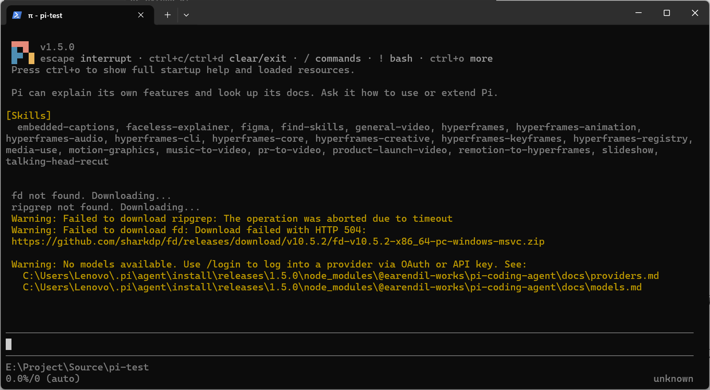

### 任务二：配置模型并完成一次会话

在 DeepSeek 官方 API 平台创建密钥后，回到 Pi 输入 `/login`，选择 **Sign in with an API key**，提供商选择 DeepSeek 完成配置（密钥按输脱敏原则不截图、不提交 `auth.json`）。

配置完成后发送提示词 `ready?`，模型正常回复“Ready. What would you like to work on in E:/Project/Source/pi-test?”，底部状态栏显示当前模型 `deepseek-flash · thinking off`，证明会话链路可用。

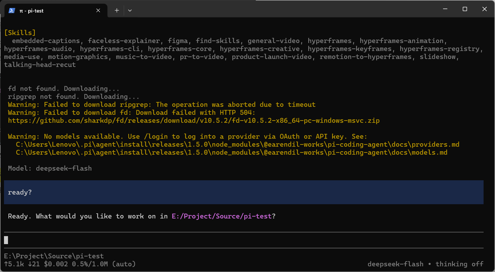

### 任务三：切换模型与模型思考级别

输入 `/thinking` 打开 Thinking Level 菜单，可见当前级别为 `off`（可选 off / low / high / max）。将其切换为 `high` 后，发送“So what's your thinking level?”验证：模型自行执行 `env | grep -i '^PI_'` 查询环境变量，确认 `PI_REASONING_LEVEL=high`，底部状态栏同步变为 `deepseek-flash · high`，证明切换生效。

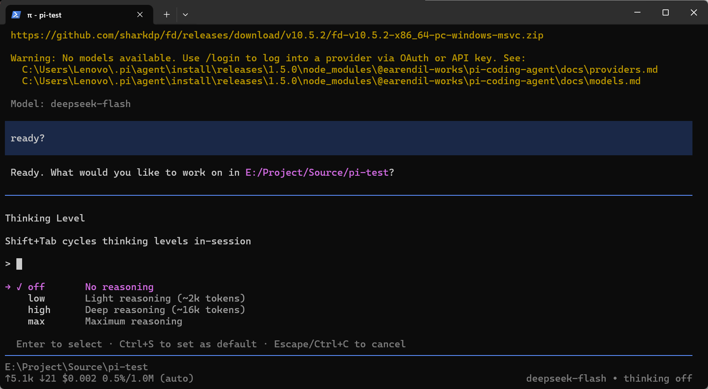

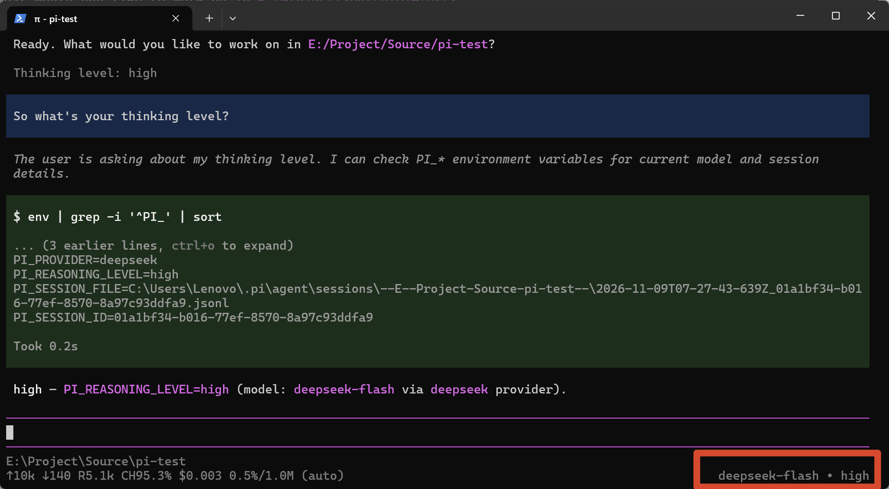

模型切换方面，会话中通过 `/model` 将模型由 `deepseek-flash` 切换为 `deepseek-v4-pro`，后续任务四、五截图右下角的状态栏可见切换结果。体会：思考级别是推理深度的设置而非更换模型；简单问答用默认级别即可，复杂解释/多工具任务用 `high` 更稳，但等待时间与用量随之增加。

### 任务四：@ 引用代码文件 + 粘贴小图片

**A. 使用 @ 引用代码文件**：在练习目录创建 `hello.py`（定义 `add(a, b)` 并 `print(add(2, 3))`）。在 Pi 输入 `@`，从候选列表中选中 `hello.py`，再发送提示词“请解释 @hello.py 的功能，说明运行后输出什么。只解释，不修改文件。”模型执行 `read hello.py` 后正确解释了 `add` 函数，并给出运行输出 `5`。

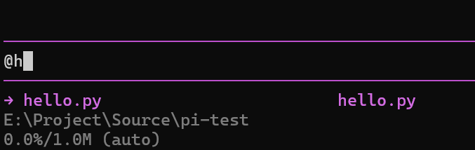

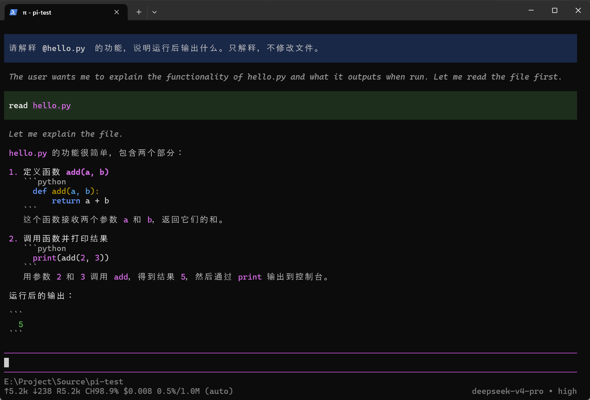

**B. 粘贴小图片并测试**：用画图工具绘制一张蓝底白字“2026”的小图片（约 112×50 像素），截图到剪贴板后在 Pi 输入区按 Alt+V 粘贴，出现图片附件后发送“请描述图片中的颜色、形状和数字。”模型正确识别：天蓝色背景（约 `#29ABE2`）、白色无衬线数字、横向长方形、内容为 **2026**，与原图一致。

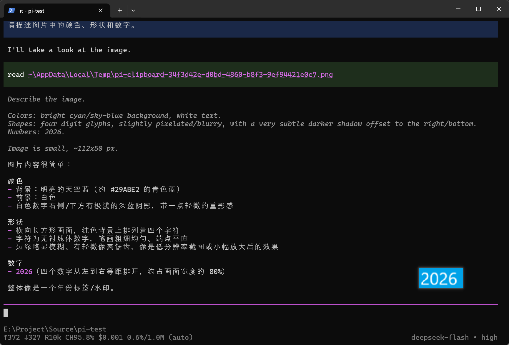

原始小图片（供与识别结果核对）：

### 任务五：安装并使用一个插件

从 Pi Packages 选用插件 **pi-web-access**（为模型提供网页抓取工具）。执行个人级安装命令 `pi install npm:pi-web-access`，输出 `added 211 packages in 52s`、`Installed npm:pi-web-access`。

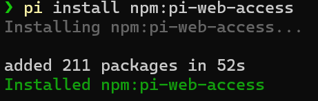

完全退出原会话并重新运行 `pi`，启动信息中出现 `[Extensions]` 区域并列出 `pi-web-access:dist`，证明插件已随启动加载（而非仅安装成功）。

![S6-2：重启 pi 后 [Extensions] 区域显示 pi-web-access:dist](images/S6_2.png)

试用最小功能，发送“请获取 https://cise.hunnu.edu.cn 的页面标题”。模型调用插件的 `fetch`（readable 模式）与 `get_content`、raw 模式 `fetch` 工具，最终给出正确标题：**湖南师范大学信息科学与工程学院**。加载成功与联网功能可用两个层面均得到验证。

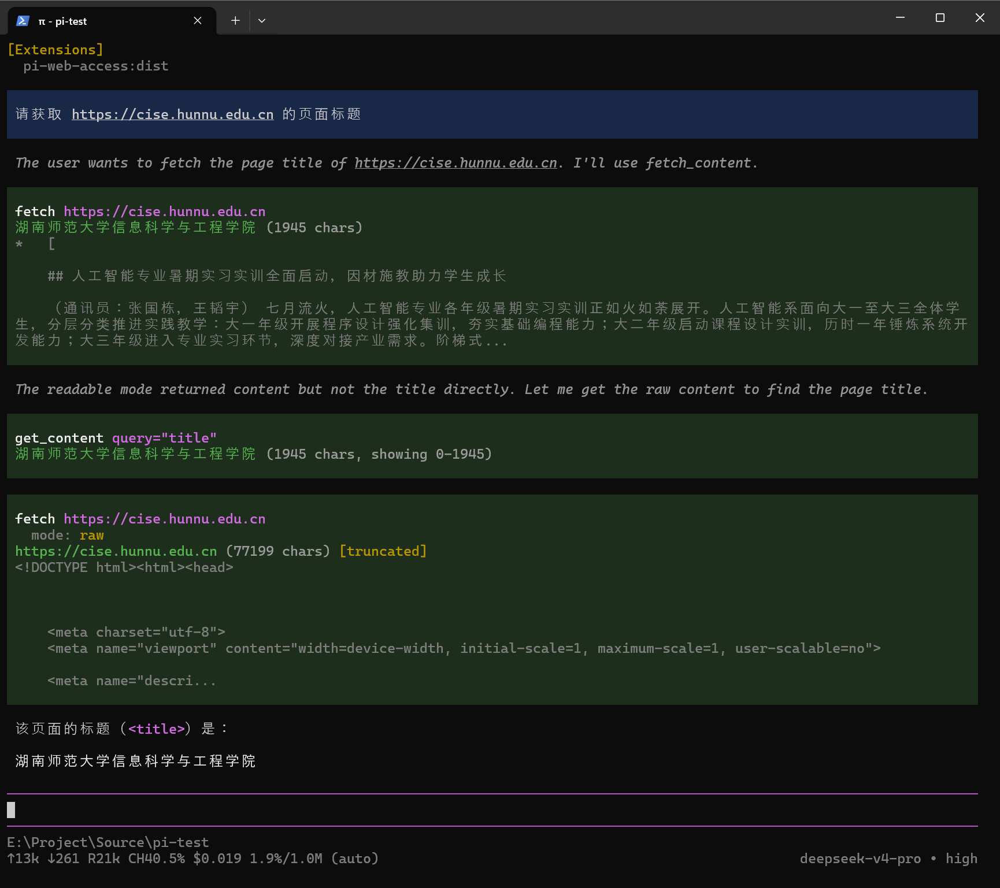

### 任务六：让 AI 安装 PPT Skill（选做项）

**安装**：向 Pi 发送提示词，要求从 `https://github.com/anthropics/skills` 下载 `skills/pptx` 完整目录安装到当前项目的 `.pi/skills/pptx`，保留 `SKILL.md`、`LICENSE.txt` 与 `scripts/` 支持文件，记录源 commit，且不自动安装依赖。AI 完成下载并生成元数据文件 `SOURCE.txt`（源 commit `2c5958ec…`，56 个源文件），报告了目录结构。

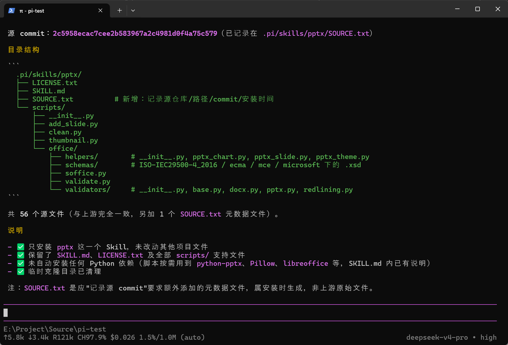

在资源管理器中核对实际目录 `E:\Project\Source\pi-test\.pi\skills\pptx`，可见 `scripts/`、`LICENSE.txt`、`SKILL.md`、`SOURCE.txt`，与报告一致。

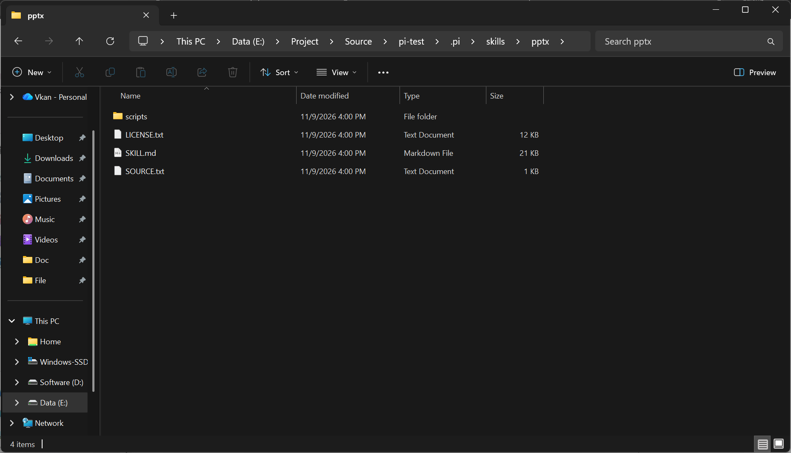

**发现**：完全退出后重新运行 `pi`，按 Ctrl+O 查看启动帮助，`[Skills]` 的 project 区域列出 `E:\Project\Source\pi-test\.pi\skills\pptx\SKILL.md`，证明重启后被自动发现（同一界面中 `[Extensions]` 也显示用户级插件 `npm:pi-web-access`）。

![S8-1：重启 pi 后 [Skills] 中发现项目级 pptx Skill](images/S8_1.png)

**调用**：输入 `/skill:pptx 请说明这个 Skill 的名称、用途和所在目录`，模型基于 Skill 内容回答：名称 `pptx`，位于 `E:\Project\Source\pi-test\.pi\skills\pptx`，用于 `.pptx` 文件的创建、编辑与分析。

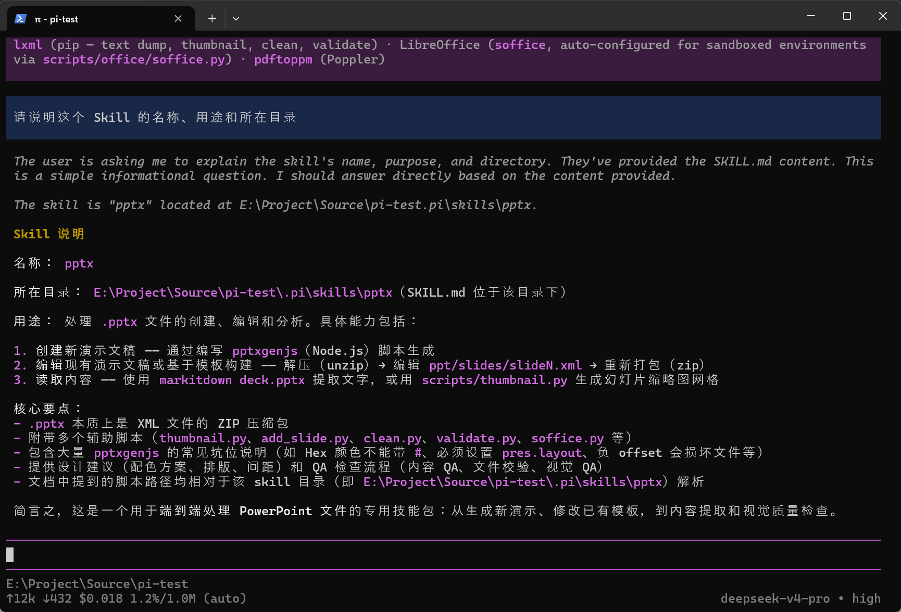

**生成 PPT（选做）**：让 AI 用该 Skill 生成两页最小 PPT（第一页 `Hello, PPTX SKILL!`，第二页 `Bye!`）。过程按 Skill 指引完成：用 `pptxgenjs` 编写生成脚本（首次 `require` 失败，`npm install pptxgenjs` 后正常），`validate.py` 全部校验通过，并解压 XML 确认两页文本无误；环境差异由 AI 现场绕开（`markitdown` 未安装改用解压 `grep` 校验、`soffice.py` 的 `socket.AF_UNIX` 在 Windows 不可用改直接调用本机 LibreOffice、本机 `pdftoppm` 不支持 `-jpeg` 改用 `-png`）。产物 `output.pptx` 与脚本 `make_deck.js` 已随本仓库提交。

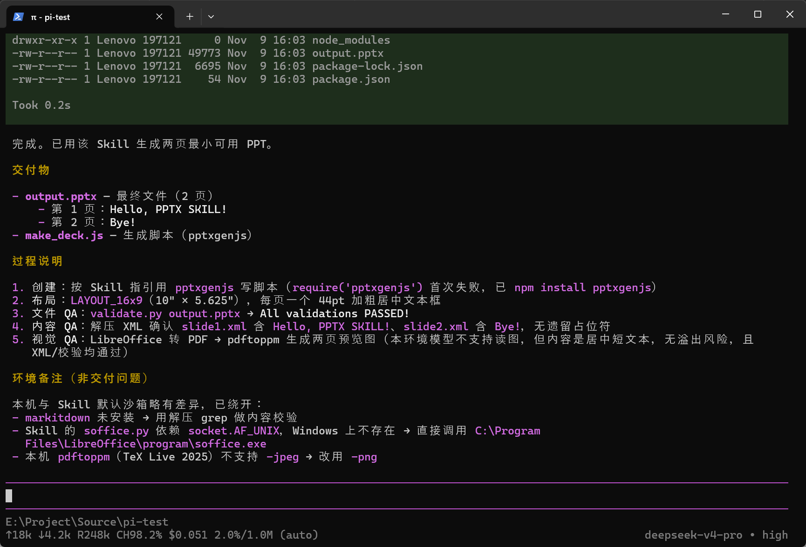

用 PowerPoint 打开 `output.pptx` 验证：两页内容正确、文件可正常打开。

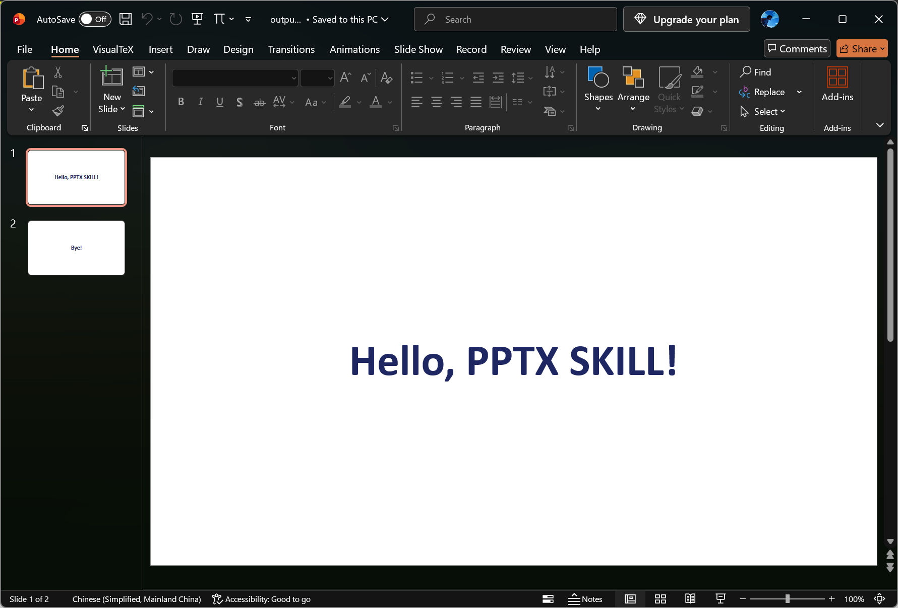

## 四、实验总结

本次实验完整走通了 Pi Agent“安装 → 配置模型 → 会话 → 切换模型/思考级别 → 文件与图片输入 → 插件 → Skill”的链路。几点收获：

1. **客户端与模型解耦**：`No models available` 不代表安装失败，只说明尚未配置提供商；模型能力、计费均来自 API 提供商，模型名以 `/model` 当前列表为准。
2. **模型与思考级别的选择是权衡**：`deepseek-flash` 满足日常问答，复杂解释与多工具任务切到 `deepseek-v4-pro · high` 更稳，但等待时间与 token 用量明显上升。
3. **插件与 Skill 机制不同**：Extension 通过 `pi install`（npm）安装、以工具形式被调用；Skill 是放入 `.pi/skills/` 的说明与支持文件目录，重启后被发现、`/skill:` 显式调用。“安装成功、发现成功、调用成功、产出成功”是四个独立层次，需要分别取证。
4. **网络与环境差异是常态**：`fd`/`ripgrep` 下载失败不影响主体功能；Skill 文档假设的依赖（markitdown、Unix socket 等）在本机不一定成立，应按实际环境核验后绕行，而不是照搬文档。
5. **`@` 引用与图片粘贴**让 agent 能“看代码、看图”，配合脱敏意识（不提交密钥、`auth.json`、授权回调）可以安全地完成日常开发辅助。
