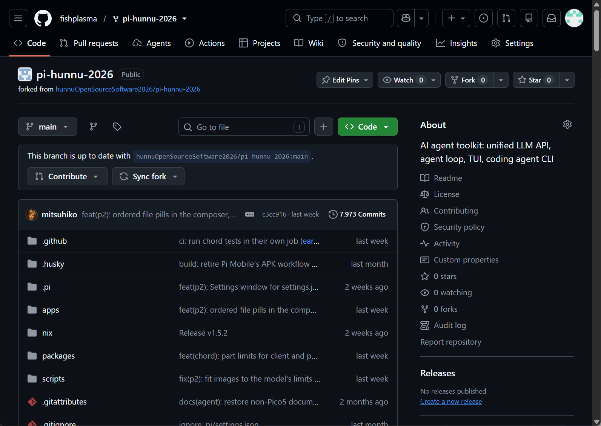
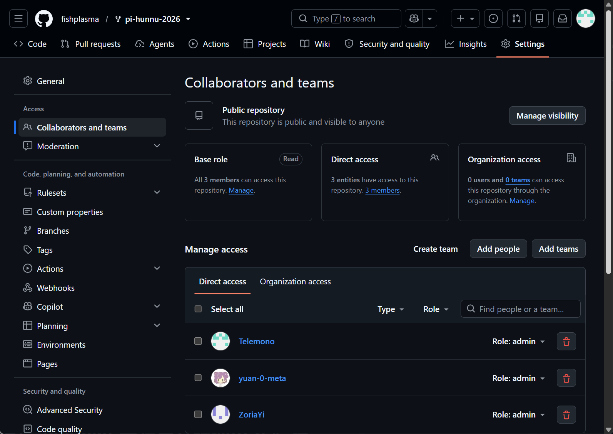
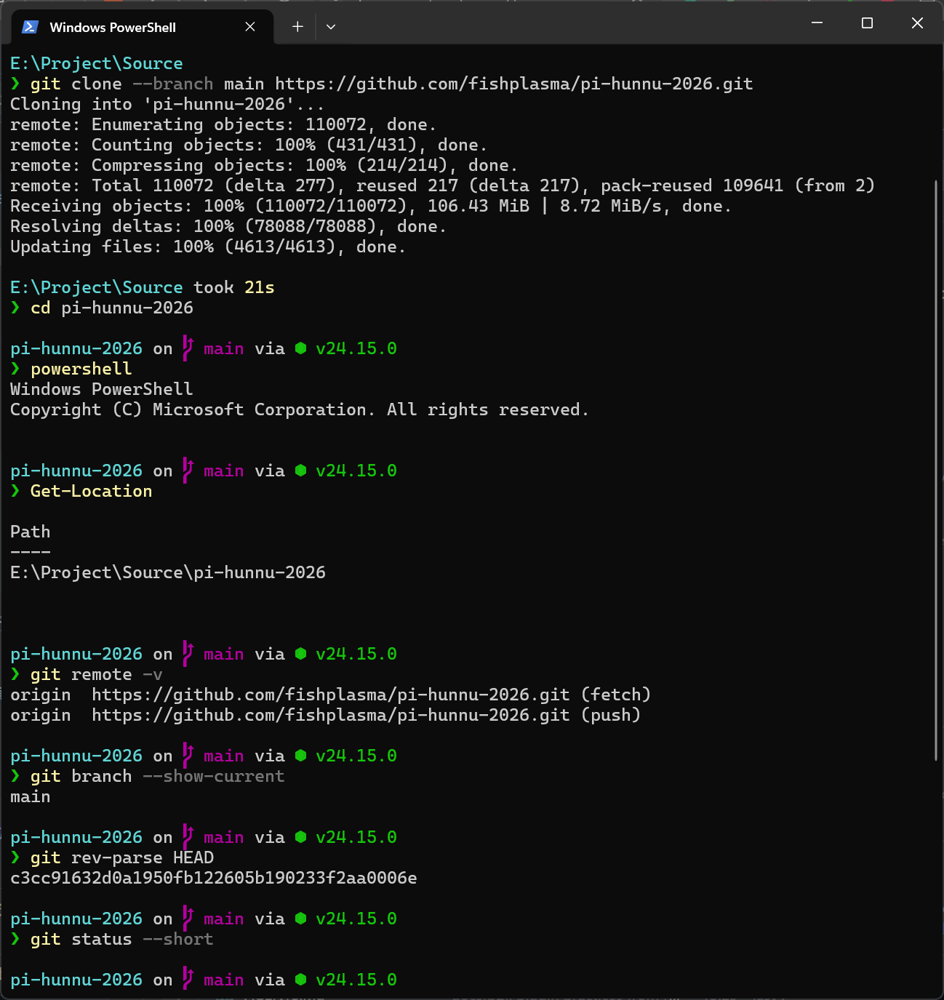
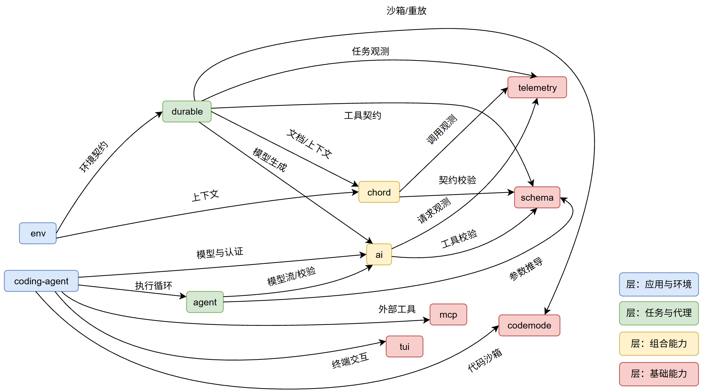
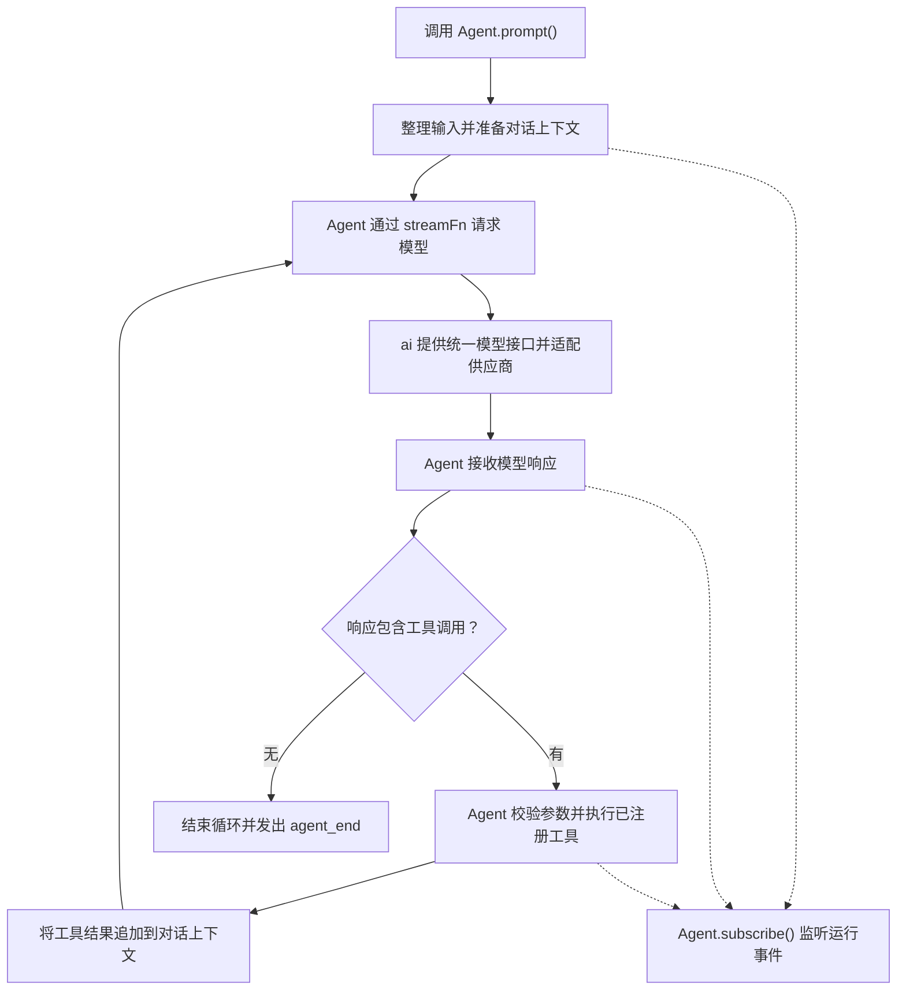

# 实践课2：小组组织建仓与 Pi Agent 源码阅读

姓名：jinsilong

学号：202430142017

GitHub：Telemono

组织：fishplasma

## 一、Fork + Clone + Check (任务一 + 任务二)

## Fork + Check

已经 Fork 到组织仓库 (https://github.com/fishplasma/pi-hunnu-2026)。

我们小组三位组员都具有访问权限。

## Clone + Check

已经将该仓库 Clone 到本地，检查通过，如图所示。

这张图展示了 Clone 的过程、展示 remote 的过程，没有发现问题。

这张图实际上也是截图要求S1，它里面包含了当前目录、远端地址、分支和提交编号。

## 二、分析子模块功能与依赖关系 (任务三)

## 子模块功能与依赖关系

| 子文件夹       | 代码主要实现什么功能                                         | 本模块 build 执行什么、生成什么 | 直接依赖哪些内部模块 | 依据文件或代码位置 |
| -------------- | ------------------------------------------------------------ | ------------------------------- | -------------------- | ------------------ |
| `telemetry`    | 记录模型性能、运行概况，也能让不同模块去描述。例如，一次模型请求可以记录开始时间、耗时、模型名称、token 数量和错误。代码中的 **span** 就是一项操作从开始到结束的记录。 | 运行 `tsc -p tsconfig.build.json`，将 `src` 编译为 `dist` 下的 JavaScript、类型声明和 source map。 | 无 | `packages/telemetry/package.json`、`packages/telemetry/tsconfig.build.json`、`packages/telemetry/src/index.ts` |
| `schema`       | 允许开发者写出规则，再用这些规则检查实际数据。例如，一个读取文件的工具要求参数是 `{ "path": "配置文件路径" }`。Schema 可以表达“`path` 必须存在，而且必须是字符串”，并指出收到的数据哪里违反规则。 | 运行 `tsc -p tsconfig.build.json`，生成 `dist` 下的数据规则与校验实现、类型声明和 source map。 | 无 | `packages/schema/package.json`、`packages/schema/tsconfig.build.json`、`packages/schema/src/index.ts`、`packages/schema/src/validator.ts` |
| `chord`        | 约定插件、界面、后台等模块之间协作的通用机制。例如，可以约定某项功能接收的参数、返回的结果，实现插件、模块之间的互通。 | 运行 `tsc -p tsconfig.build.json`，生成 `dist` 下的协作、数据校验和适配实现、类型声明和 source map。 | `schema`、`telemetry` | `packages/chord/package.json`、`packages/chord/tsconfig.build.json`、`packages/chord/src/data/validator.ts`、`packages/chord/src/context/index.ts` |
| `tui`          | 在终端显示和操作界面，如输入框，列表，Markdown渲染，焦点处理等等。 | 运行 `tsc -p tsconfig.build.json`，生成 `dist` 下的终端界面库、类型声明和 source map。原生扩展由单独的 `build:native:*` 脚本构建。 | 无 | `packages/tui/package.json`、`packages/tui/tsconfig.build.json`、`packages/tui/src/index.ts` |
| `codemode`     | 提供一个受控的 JavaScript 执行环境，允许模型用简单的 JS 语句，组合它能调用的工具。例如可以用循环、条件判断等代码，把工具调用变得清晰。 | 运行 `tsc -p tsconfig.build.json`，生成 `dist` 下的代码执行环境、类型声明和 source map。 | 无 | `packages/codemode/package.json`、`packages/codemode/tsconfig.build.json`、`packages/codemode/src/index.ts` |
| `mcp`          | 实现 MCP 客户端，使得 Pi 可以连接到其他应用提供的 MCP 工具，它处理 MCP 服务器连接、协商协议等职责。 | 运行 `tsc -p tsconfig.build.json`，生成 `dist` 下的 MCP 客户端、传输与认证实现、类型声明和 source map。 | 无 | `packages/mcp/package.json`、`packages/mcp/tsconfig.build.json`、`packages/mcp/src/client.ts` |
| `ai`           | 提供统一的模型、消息和调用接口，接入不同模型提供商。         | 运行 `generate-models` 生成模型目录，再校验模型数据、编译 TypeScript，并复制模型数据到 `dist/providers/data`。 | `schema`、`telemetry` | `packages/ai/package.json`、`packages/ai/tsconfig.build.json`、`packages/ai/src/utils/validation.ts`、`packages/ai/src/telemetry.ts` |
| `durable`      | 长任务可能遇到程序退出、连接中断等突发情况，该模块可以把对话、任务状态、工具结果等需要保存的数据存储下来，以便以后再次恢复执行。 | 运行 `tsc -p tsconfig.build.json`，生成 `dist` 下的对话、任务、持久化和恢复实现、类型声明和 source map。 | `chord`、`ai`、`codemode`、`schema`、`telemetry` | `packages/durable/package.json`、`packages/durable/tsconfig.build.json`、`packages/durable/src/harness/generation.ts`、`packages/durable/src/codemode/codemode.ts`、`packages/durable/src/harness/tool.ts`、`packages/durable/src/harness/telemetry.ts`、`packages/durable/src/documents.ts` |
| `env`          | 让工具调用变得环境无关，该模块适配不同操作系统、本地或者远程模式，转换为适用于本地环境的命令。如果是 SSH 等远程访问模式，还可以管理客户端连接。 | 运行 `tsc -p tsconfig.build.json`，生成 `dist` 下的本地与远端执行环境客户端、类型声明和 source map。Rust daemon 由单独的 `build:daemon` 构建。 | `durable`、`chord`（仅类型） | `packages/env/package.json`、`packages/env/tsconfig.build.json`、`packages/env/src/remote-env.ts`、`packages/env/src/index.ts` |
| `agent`        | 安排模型与工具，让 Pi 能一轮轮地完成任务，即消息循环，准备消息，接收模型输出，执行工具，把结果放回对话，执行下一轮，如此往复，直至无工具再次调用，任务结束。 | 运行 `tsc -p tsconfig.build.json`，生成 `dist` 下的 Agent 与执行循环、类型声明和 source map。 | `ai`、`schema`（仅类型） | `packages/agent/package.json`、`packages/agent/tsconfig.build.json`、`packages/agent/src/agent-loop.ts`、`packages/agent/src/types.ts` |
| `coding-agent` | 是 Pi 的命令行程序，允许其他程序调用它的接口。相当于把 Pi 本身做成一个类似 MCP 服务器的模块，供其他服务调用。 | 编译 TypeScript、设置 CLI/RPC 入口权限并复制运行资源，再由打包脚本生成 `dist/bundle` 中的 CLI 和 RPC bundle。 | `agent`、`ai`、`codemode`、`mcp`、`tui` | `packages/coding-agent/package.json`、`packages/coding-agent/tsconfig.build.json`、`scripts/build-coding-agent-bundle.mjs`、`packages/coding-agent/src/core/sdk.ts`、`packages/coding-agent/src/core/model-runtime.ts`、`packages/coding-agent/src/extensions/codemode/execute.ts`、`packages/coding-agent/src/extensions/mcp/runtime.ts`、`packages/coding-agent/src/cli/config-selector.ts` |

### 依赖关系图

> [!tip]
>
> 这张图是我用 Draw.io 画的，可以在 https://draw.io 打开。
>
> - 可在[这里](./Pi.drawio.pdf)下载 PDF 版。
> - 可在[这里](./Pi.drawio)下载 Draw.io 源码。

## 重点分析的模块

重点分析了 `agent` 模块。选择 `agent`，是因为它负责组织模型请求和工具执行之间的循环，能把依赖图中的 `coding-agent → agent → ai` 这条路径具体说明。它提供了通用的执行能力。

- **状态管理**：`Agent` 保存当前模型、思考等级、工具列表和对话消息，公开当前是否正在流式响应、正在执行的工具调用，以及最近的错误状态。当调用 `prompt()`，也就是发送一条消息后，Agent 会将输入整理为消息并启动一次运行。

  > [!note]
  >
  > 源码见 `packages/agent/src/agent.ts` 和 `packages/agent/src/types.ts`。

- **模型与工具循环**：执行循环先通过传入的 `streamFn` 请求模型。模型返回工具调用时，Agent 校验参数、执行对应工具，并将工具结果追加到对话上下文，再开始后续模型轮次。循环结束后发出 `agent_end` 事件。

  > [!note] 
  >
  > 源码见 `packages/agent/src/agent-loop.ts`。

- **模块分工**：`agent` 依赖 `ai` 提供的模型消息类型、事件流和参数校验等能力。它也依赖 `schema` 的 `Static` 类型来推导工具参数类型，这条依赖只用于类型。模型供应商接入和具体工具由上层应用提供，Agent 负责调度它们。

`coding-agent` 负责把模型、工具和用户界面组装成编程代理，`agent` 管理执行循环和对话状态，`ai` 负责统一模型接口及供应商适配。

执行流程可以用下图表示：

## 三个问题

**（1）** 根目录与子模块中的 `npm run build` 分别读取什么配置、执行什么工作？

**A. 根目录**

a. 读取的配置：根目录 `package.json` 中的 `scripts.build`。

b. 执行的工作：按脚本列出的顺序，依次进入 11 个 `packages/*` 子目录并执行各自的 `npm run build`，负责组织构建流程。

> [!warning]
>
> 它本身不调用根目录 `tsconfig.json` 编译 TypeScript。

**B. 子模块**

a. 读取的配置：对应子模块 `package.json` 中的 `scripts.build`，以及该脚本调用的构建配置。

例如，多数模块运行 `tsc -p tsconfig.build.json`，由本模块的 `tsconfig.build.json` 指定编译配置。

b. 执行的工作：多数模块将 TypeScript 源码编译到 `dist`。

部分模块还执行额外步骤。例如，`ai` 先生成模型目录再构建，`coding-agent` 编译、复制资源后再打包。

> [!note]
>
> 以下是根目录 `npm run build` 依次调用的 11 个包，各包构建脚本和执行内容：
>
> | 包             | 读取的配置                                                   | 执行的操作                                                   |
> | -------------- | ------------------------------------------------------------ | ------------------------------------------------------------ |
> | `telemetry`    | `packages/telemetry/package.json` 的 `scripts.build`；`tsconfig.build.json` | 运行 `tsc -p tsconfig.build.json`，将 TypeScript 源码编译到 `dist`。 |
> | `schema`       | `packages/schema/package.json` 的 `scripts.build`；`tsconfig.build.json` | 运行 `tsc -p tsconfig.build.json`，将 TypeScript 源码编译到 `dist`。 |
> | `chord`        | `packages/chord/package.json` 的 `scripts.build`；`tsconfig.build.json` | 运行 `tsc -p tsconfig.build.json`，将 TypeScript 源码编译到 `dist`。 |
> | `tui`          | `packages/tui/package.json` 的 `scripts.build`；`tsconfig.build.json` | 运行 `tsc -p tsconfig.build.json`，将 TypeScript 源码编译到 `dist`。原生扩展由单独的 `build:native:*` 脚本构建，不属于默认 `build`。 |
> | `codemode`     | `packages/codemode/package.json` 的 `scripts.build`；`tsconfig.build.json` | 运行 `tsc -p tsconfig.build.json`，将 TypeScript 源码编译到 `dist`。 |
> | `mcp`          | `packages/mcp/package.json` 的 `scripts.build`；`tsconfig.build.json` | 运行 `tsc -p tsconfig.build.json`，将 TypeScript 源码编译到 `dist`。 |
> | `ai`           | `packages/ai/package.json` 的 `scripts.build`、`build:offline`；`tsconfig.build.json` | 先运行 `generate-models` 生成模型数据，再校验模型数据、编译 TypeScript，并复制模型数据到 `dist/providers/data`。 |
> | `durable`      | `packages/durable/package.json` 的 `scripts.build`；`tsconfig.build.json` | 运行 `tsc -p tsconfig.build.json`，将 TypeScript 源码编译到 `dist`。 |
> | `env`          | `packages/env/package.json` 的 `scripts.build`；`tsconfig.build.json` | 运行 `tsc -p tsconfig.build.json`，将 TypeScript 源码编译到 `dist`。Rust 远端程序由单独的 `build:daemon` 构建，不属于默认 `build`。 |
> | `agent`        | `packages/agent/package.json` 的 `scripts.build`；`tsconfig.build.json` | 运行 `tsc -p tsconfig.build.json`，将 TypeScript 源码编译到 `dist`。 |
> | `coding-agent` | `packages/coding-agent/package.json` 的 `scripts.build`、`build:unbundled`；`tsconfig.build.json` | 编译 TypeScript，设置 CLI/RPC 入口文件执行权限，复制主题、图片和 HTML 导出资源，再运行打包脚本生成 bundle。 |
>

**（2）构建顺序和模块依赖有什么关系？相邻构建的模块是否一定互相依赖？**

**关系**：通常情况下，模块依赖决定构建先后，依赖方构建时需要被依赖方的构建产物，因此先构建被依赖方。

例如，`agent → ai`。`agent` 依赖 `ai`，根脚本先构建 `ai`，再构建 `agent`。

不过也有例外的情况：`chord → schema`。`chord` 依赖 `schema`，根脚本却先构建 `chord`，再构建 `schema`。

相邻构建的模块，**不一定**互相依赖。

例如，根脚本先后构建 `chord` 和 `tui`。`chord` 依赖 `schema`、`telemetry`，`tui` 在这 11 个包中没有内部直接依赖，因此这两个相邻包之间没有直接依赖关系。

**（3）选择一条涉及至少三个模块的依赖路径，说明这些模块如何分工**

依赖路径：`coding-agent → agent → ai`（箭头表示前者依赖后者）。分工如下：

- `coding-agent` 将通用 Agent 循环、模型调用和终端交互组装成 Pi 编程代理；
- `agent` 负责准备对话上下文、接收模型输出、执行工具并把结果交回模型；
- `ai` 提供统一的模型、消息、流式调用接口以及不同模型供应商的适配。
- 源码中 `coding-agent` 直接依赖 `agent`，`agent` 直接依赖 `ai`。
