# 实践课3：Pi Agent 源码安装与编译

姓名：jinsilong

学号：202430142017

GitHub：Telemono

组织：fishplasma

## 一、实验准备

### 环境检查

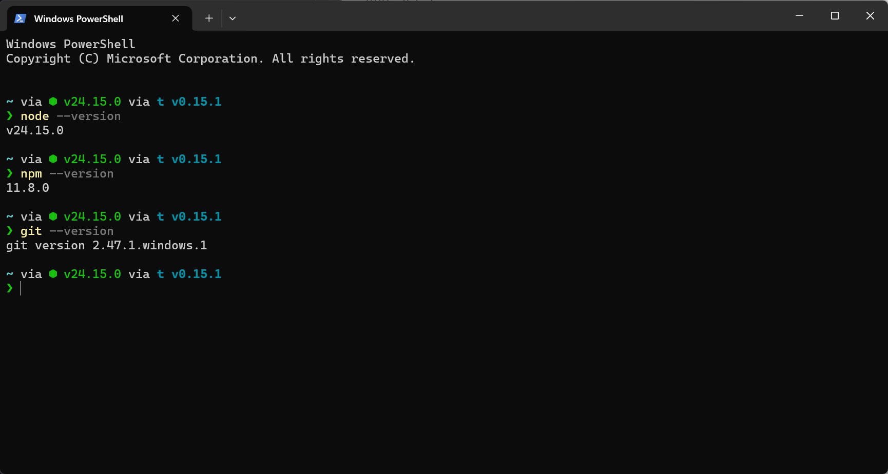

安装的 Node.js 版本是正确的。不需要用 fnm，跳到任务二。

## 二、下载课程仓库源码

上次实验做过了，不过保守起见我再放一次，哈哈。

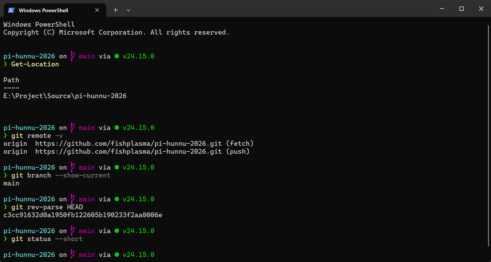

可以看到当前目录、远程地址、分支、提交编号都是对的。

## 三、阅读配置

我这里选用的编辑器是 VSCode Insiders，VSCode 原版带了不少插件，想着从头配置下，于是就单开了一个 :P

### 根据列出文件/目录说出观察的内容

**`README.md` 中，`Development` 中提供了哪些开发命令？**

提供这些命令：

- `npm install --ignore-scripts`：安装项目依赖，不运行依赖包的 lifecycle scripts。
- `npm run build`：刷新 AI 模型数据，再依次构建全部包。
- `npm run build:offline`：使用已有模型数据构建，避免联网刷新模型目录。
- `npm run check`：运行格式、依赖、导入和 TypeScript 等检查。
- `./test.sh`：运行测试。没有 API key 时会跳过依赖大模型的测试。
- `./pi-test.sh`：从源码运行 Pi，可以从任意目录调用。

**`package.json` 中，`engines`、`workspaces`、`scripts`、`devDependencies` 如何理解？**

- `engines` 声明项目支持的 Node.js 版本范围。本项目要求 Node.js `>=22.19.0`。

- `workspaces` 列出同一仓库内由 npm 管理的工作区，例如 `packages/*`、`apps/*`，以及若干示例项目。npm 可以在根目录统一安装依赖，并识别工作区之间的本地包关系。

- `scripts` 把常用命令命名为脚本，例如 `build`、`check` 和 `test`。在对应目录执行 `npm run <名称>` 时，npm 从该目录的 `package.json` 中读取同名脚本。

- `devDependencies` 是开发、构建和检查时使用的依赖，例如 TypeScript、Biome 和 Husky。

  > [!note]
  >
  > 它们与包运行时需要的 `dependencies` 用途不同。

**`package-lock.json` 是锁定依赖版本和依赖关系的文件，说出理解。**

它记录 npm 安装时解析出的依赖树，包括具体包版本、依赖关系和完整性信息，也记录工作区信息。

开发者提交该文件后，其他成员可以按相同的 lockfile 安装依赖，减少因版本解析差异造成的环境变化。

`npm ci` 会依照锁文件安装，并要求它与 `package.json` 一致。

**`packages/` 是同一仓库中的多个子包，说出理解。**

每个子目录代表一个有独立 `package.json` 的包，可以声明自己的脚本、入口和依赖。

根目录的 `workspaces` 将这些包纳入同一 npm 项目，便于统一安装、构建和检查。

**`packages/coding-agent/package.json` 是 CLI 包的构建脚本和 `bin` 入口，它用来做什么？**

该包的 `build` 先运行 `build:unbundled`，由 TypeScript 编译源码、复制主题和导出页面等资源，再运行打包脚本生成 CLI 和 RPC bundle。

`bin` 将命令名 `pi` 映射到 `dist/bundle/cli.js`。

用户安装该包后，npm 会为这个入口创建可执行的 `pi` 命令。

独立的 `build:binary` 还会调用 Bun 编译单文件可执行程序。

### 找到 `engines.node` 和 `scripts.build` 的定义并回答问题

### `engines.node`

> [!tip]
>
> 项目要求 Node.js 22.19.0 或更新版本。

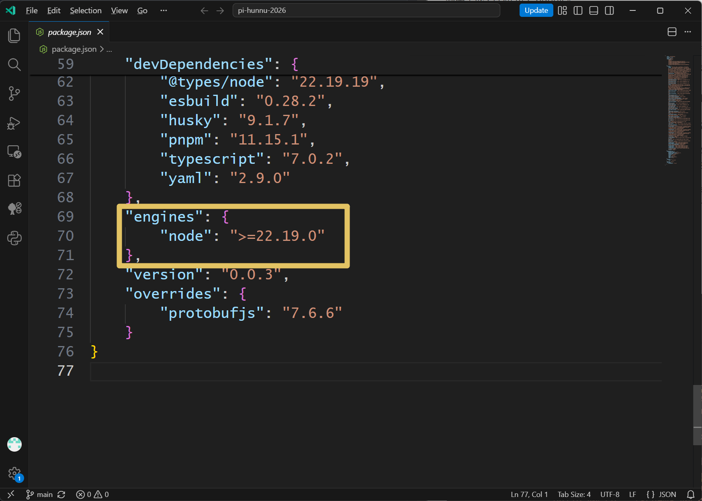

### `scripts.build`

>  [!tip]
>
> 这是根目录 `npm run build` 实际执行的命令。
>
> 每次进入一个子包目录后，`npm run build` 会读取该子包自己的 `scripts.build`。

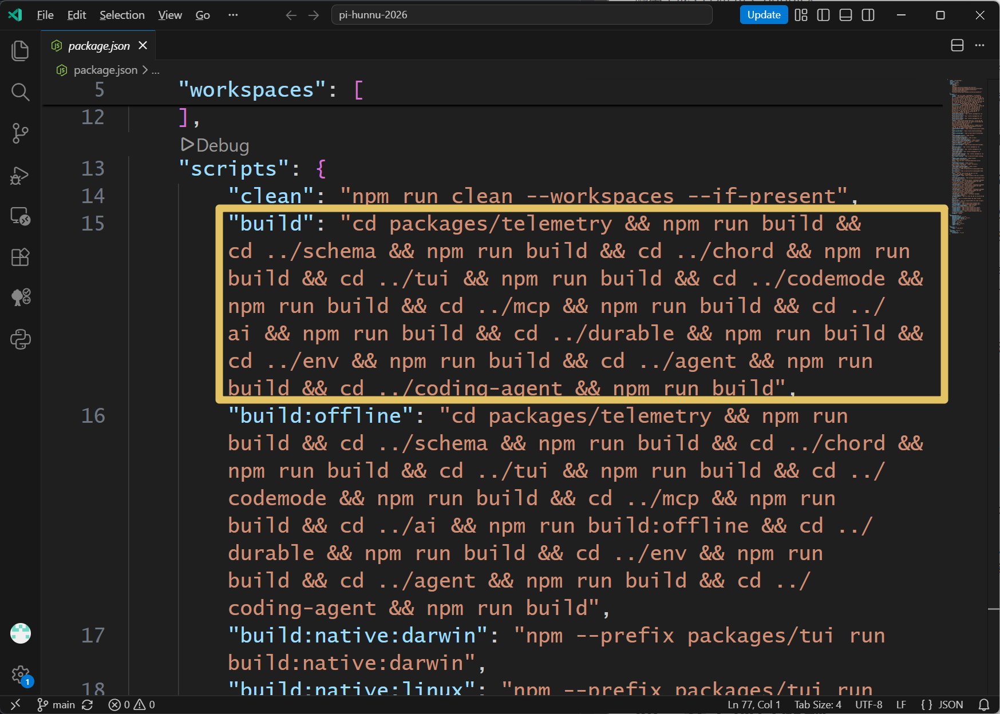

### 问题回答

结合图可知。

**Node.js 版本要求在哪里？`npm run build` 实际从哪里读取命令？**

**版本要求：**

根目录 `package.json` 的 `engines.node` 声明最低版本为 `22.19.0`。各工作区包也在自己的 `package.json` 声明 Node.js 要求。仓库 README 同样说明需要 Node.js 22.19 或更新版本。

**读取命令：**

在仓库根目录执行 `npm run build` 时，npm 读取**根目录** `package.json` 的 `scripts.build`。

这个脚本**依次进入各包目录**并运行其 `npm run build`。

进入**子包**后，npm 再读取那个子包 `package.json` 中的 `scripts.build`。

## 四、安装项目依赖

### 安装结束

没有遇到错误，出现了4个警告，不影响构建。不过有 npm 包已被标记为废弃，这个后续应该要升级一下。

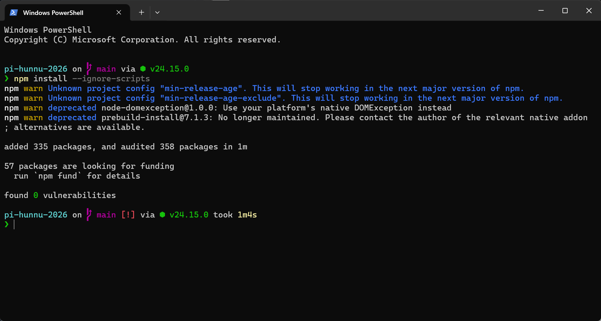

因为很久之前我已经配置好源了，所以就没有出现错误。另外，其实我推荐用 pnpm

## 五、本地编译与构建产物验证

### 首次构建

构建成功，构建产物也通过了。可以看到完整构建正常退出。退出码也是0，我用 `$LASTEXITCODE` 查的。

入口文件存在 (Test-Path返回了True)，也正确输出了版本号。

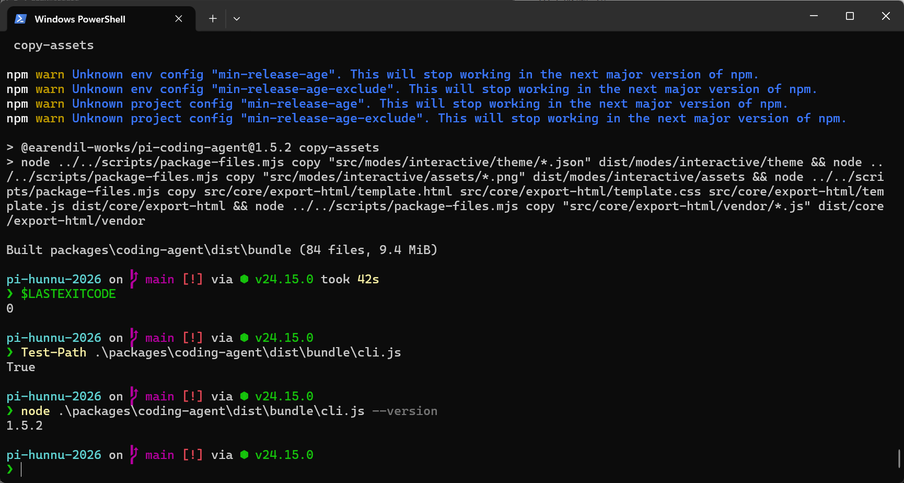

离线构建也成功了，没有下载模型数据。可以看到构建的快多了，上面的花了42s，这次只花了17s。退出码仍然是0。

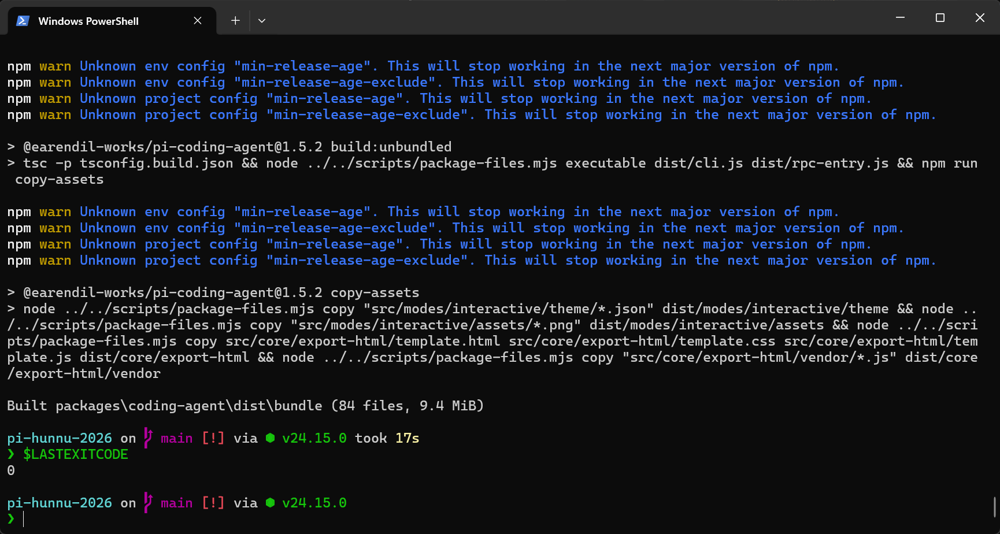

## 六、启动本地源码版本并完成一次会话

### 源码入口验证

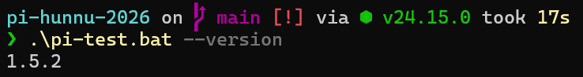

验证成功，正确返回了版本。

### 启动交互界面

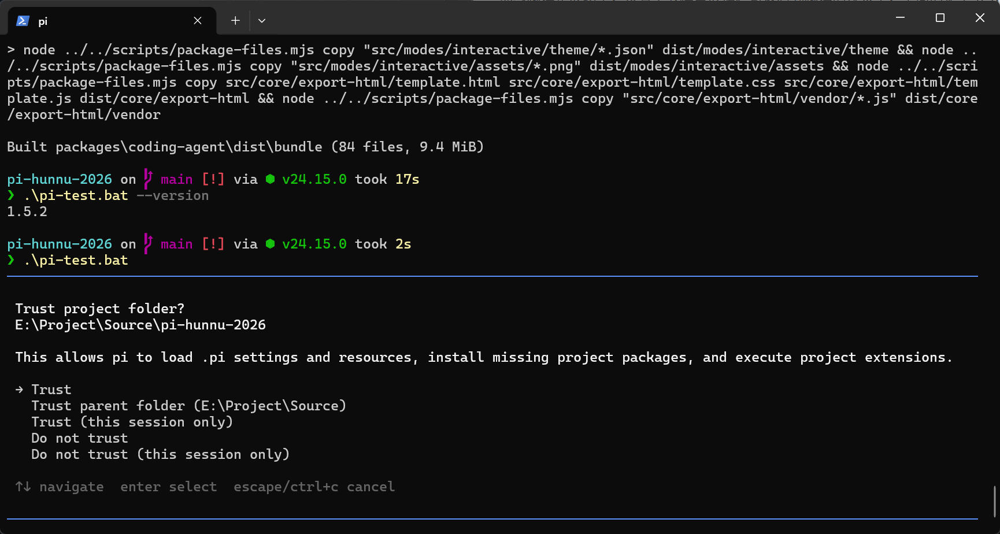

上面这张图表明我正在运行本地源码的 Pi。

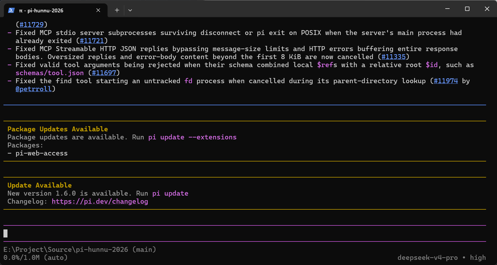

正常进入了 Pi 界面，同时右下角确实展示了之前登录的 DeepSeek Platform。

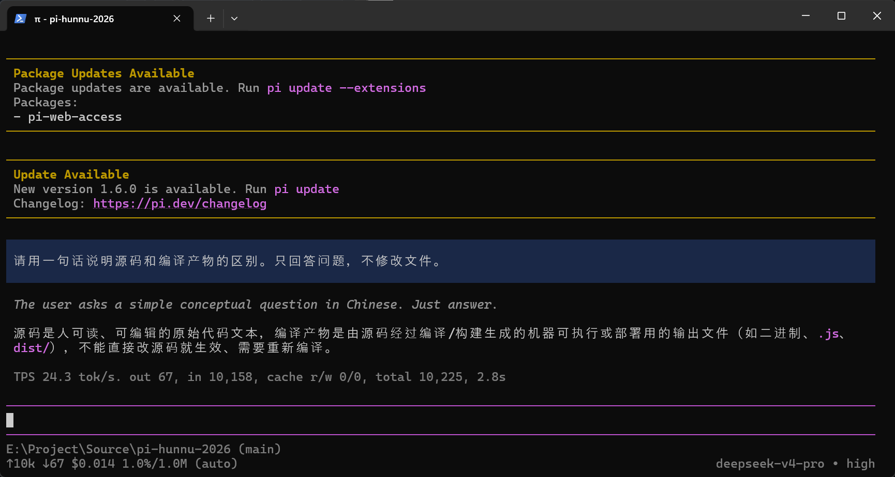

可以正常问答。

### 编译版

在 PowerShell 中执行：`node .\packages\coding-agent\dist\bundle\cli.js`，可以打开编译版。

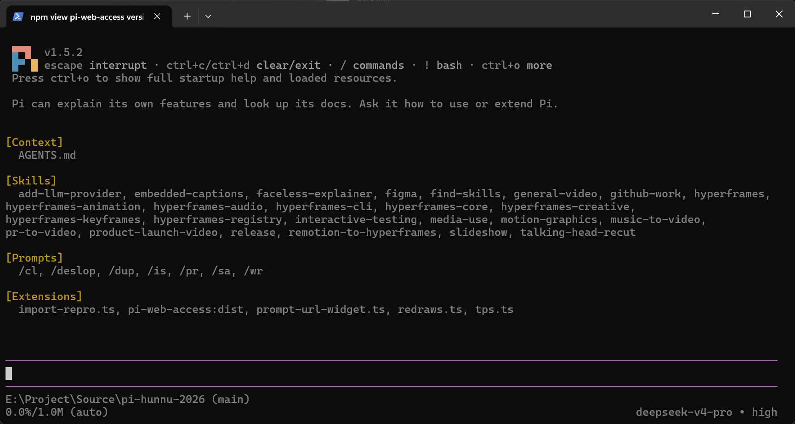

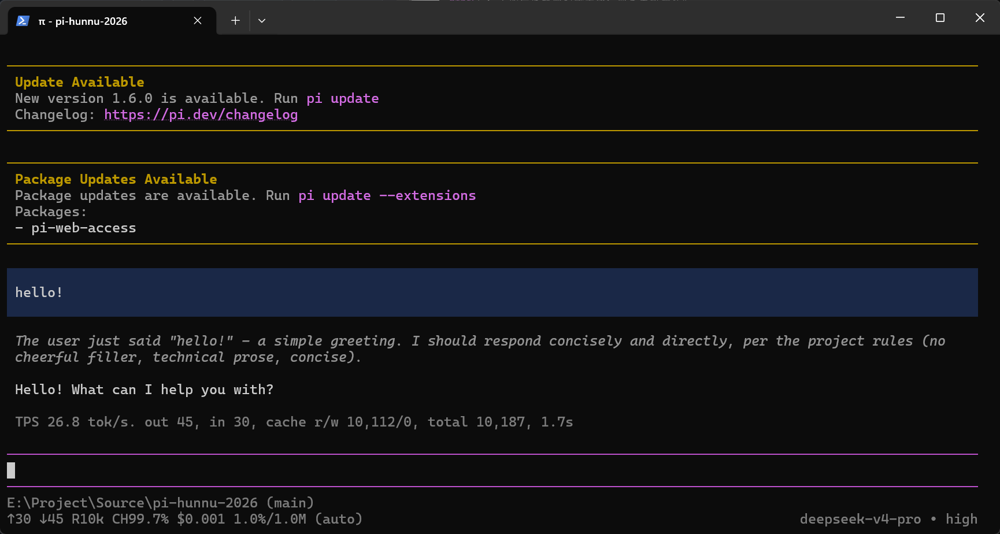

如图，也可以正常对话。

### 问题的回答

**本次如何确保运行的是本地源码？**

用 `.\pi-test.bat --version` 和 `.\pi-test.bat` 启动源码入口，而不是调用电脑上安装的全局 `pi` 命令。

> [!note]
>
> `pi-test.bat` 会转交给 `pi-test.ps1`。
>
> 脚本根据自身位置找到仓库目录，再通过 Node.js 的 `--import` 加载 `packages/coding-agent/src/experimental/source-resolver.ts`，最后运行 `packages/coding-agent/src/cli.ts`。因此实际执行的是当前 checkout 中的 TypeScript 源码。
>
> 截图中的命令是 `.\pi-test.bat`，界面底部也显示仓库路径 `E:\Project\Source\pi-hunnu-2026`。

**源码入口与 `dist/bundle/cli.js` 入口分别适合什么场景？**

**源码入口**：适合开发和调试。修改 `src` 中的代码后，可再次用源码脚本运行来验证，不必先生成 bundle。

**`dist/bundle/cli.js` 入口**：适合检查本地构建产物，也对应 `packages/coding-agent/package.json` 中 `bin.pi` 注册给用户的 CLI 入口。它由 `npm run build` 编译、复制资源并打包生成。
