# 实践课 4：Pi Agent 的模型调用与运行流程

姓名：jinsilong

学号：202430142017

GitHub：Telemono

组织：fishplasma

## 一、给 Agent 循环加两行日志

### 第一行

文件：`packages/agent/src/agent-loop.ts`，修改代码如下。

```js
console.error("[P4] Agent 即将请求模型"); // 新增
const response = await streamFunction(config.model, llmContext, {
```

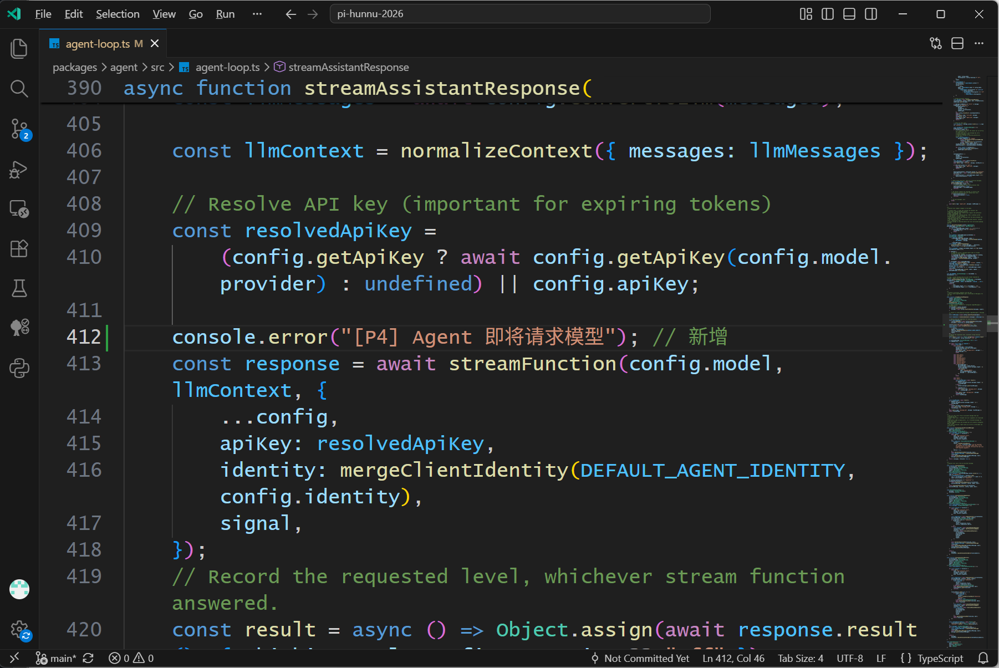

### 第二行

文件：`packages/agent/src/agent-loop.ts`，修改代码如下。

```js
for (const result of toolResults) {
    currentContext.messages.push(result);
    console.error("[P4] 工具结果已加入上下文"); // 新增
    newMessages.push(result);
}
```

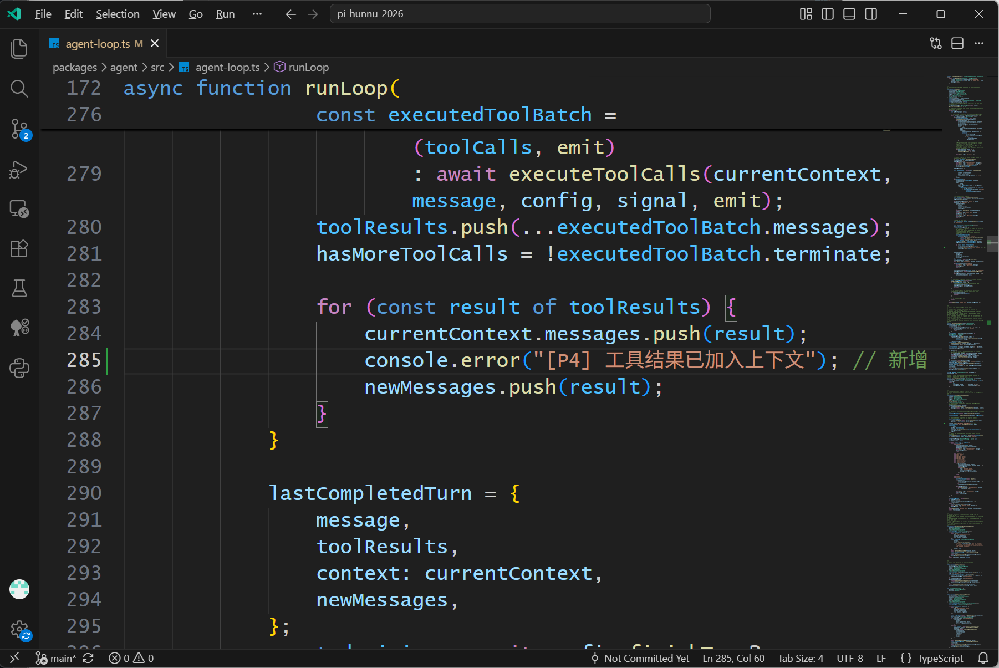

## 二、重新编译并启动

两张图，第一张图，首先是命令开始，这次执行的是全量编译，`npm run build`，会拉取模型列表。

因为刚刚 Vercel AI 连不上，我又额外执行了一次测试网络连接。连上了之后，构建顺利完成，在第二张图。

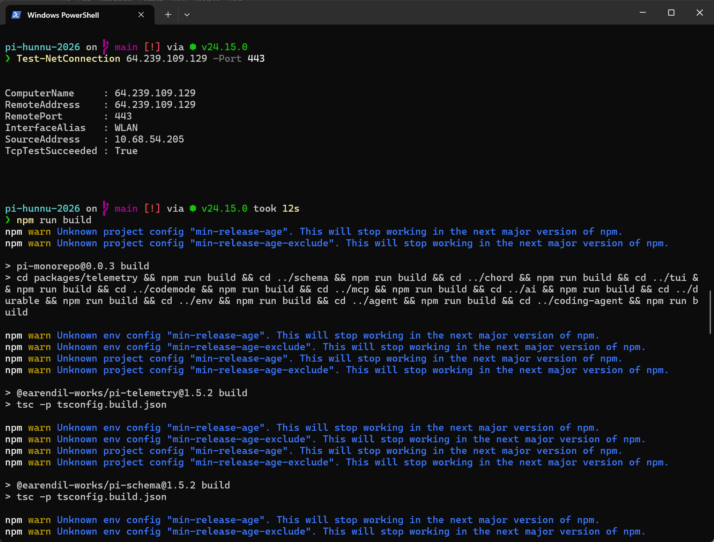

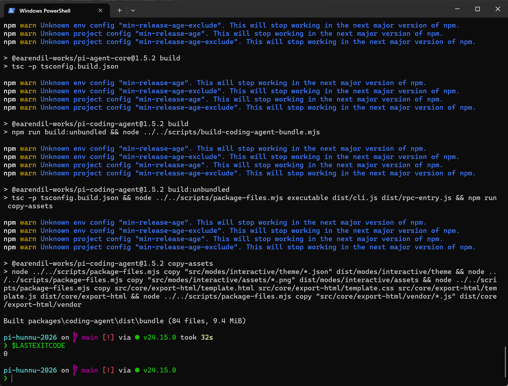

### 运行

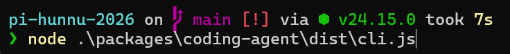

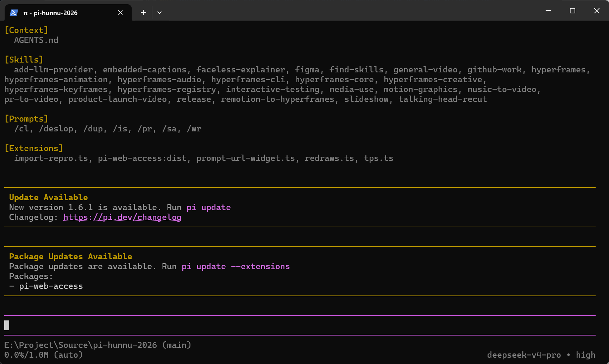

如图，成功进入交互界面。

## 三、对比两次运行

### 准备实验代号文件

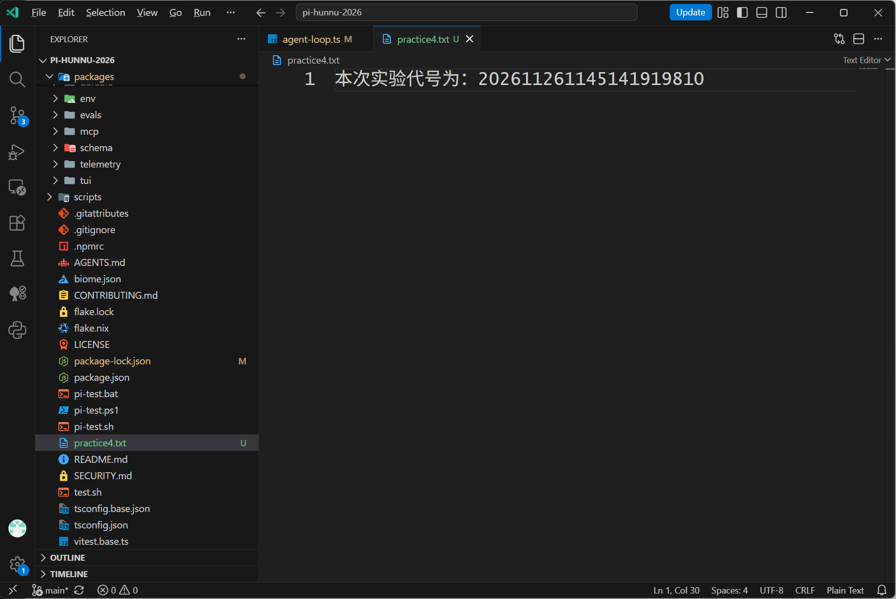

### 按照指导书给出的方法运行

#### 会话A

> 请直接用一句话解释什么是 Git 分支。

界面如下，稍后进行分析。

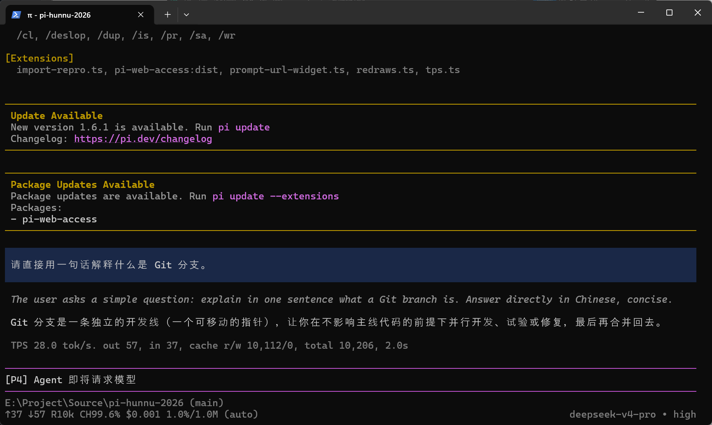

#### 会话B

另开了一个会话。

> 请用 `read` 工具读取当前目录的 `practice4.txt`，并告诉我文件中的实验代号。

界面如下，稍后进行分析。

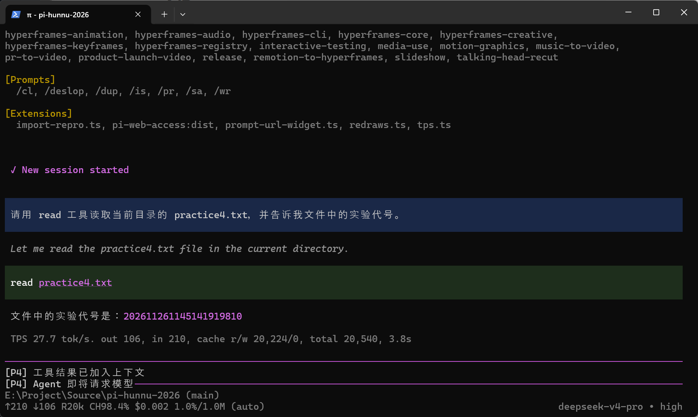

### 分析与修正

首先先说一下会话B，其实我个人觉得截图可能不太正确，按照消息原理，应该是2次Agent即将请求模型，但是我截图里只出现了一次。

我猜测可能是相同的通知被合并了？所以我在原来基础上，让它打印时间以便进行区分，代码如下。

```js
for (const result of toolResults) {
    currentContext.messages.push(result);
    console.error("[P4] 工具结果已加入上下文, 时间:" + Date.now()); // 新增
    newMessages.push(result);
}
```

```js
console.error("[P4] Agent 即将请求模型" + Date.now()); // 新增
const response = await streamFunction(config.model, llmContext, {
    ...config,
    apiKey: resolvedApiKey,
    identity: mergeClientIdentity(DEFAULT_AGENT_IDENTITY, config.identity),
    signal,
});
```

#### 重新编译并运行

然后重新编译并重新运行。

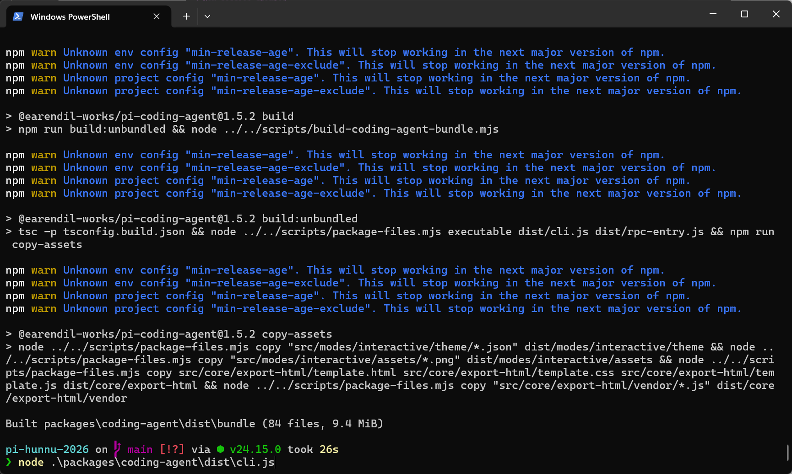

#### 会话A

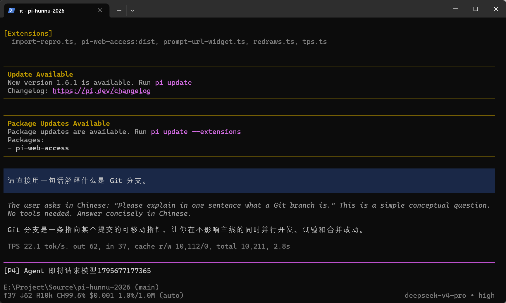

#### 会话B

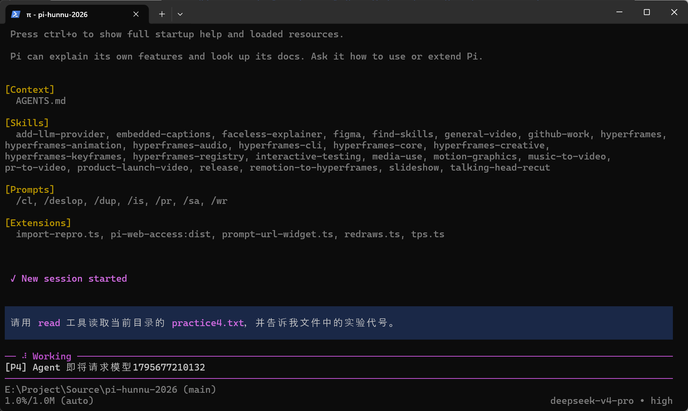

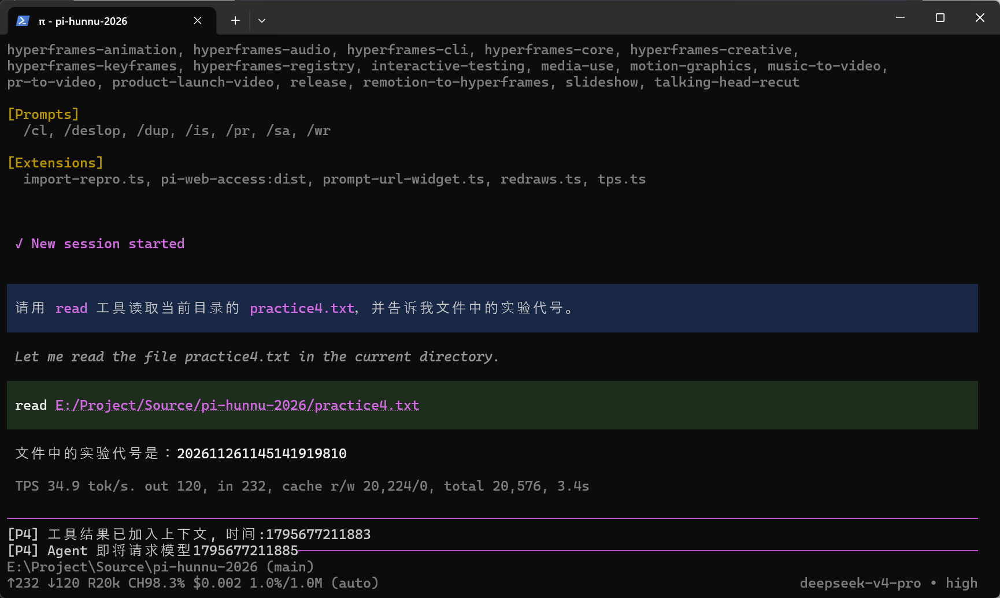

如图所示，“Agent即将请求模型”这个时间戳是对不上的，这说明这里是**两次请求**。

> [!important]
>
> 从这里来看，确实是两次请求，只不过是UI出现了重叠。
>
> 另外，在指导书中给的代码，其实在运行工具前也输出了“Agent即将请求模型”，只不过被后续的工具调用后结果顶掉了，如图所示，这个其实是刚发消息时“闪现”的即将请求模型，随后它被工具调用、工具调用后的日志覆盖，顶掉了。
>
> 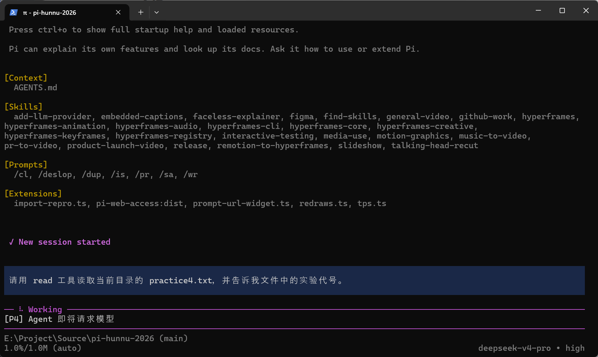

### 观察结论

就以上情况来看，观察结论其实有两版。我倾向于第二版。

| 会话 | 是否执行了工具 | 出现了几条“即将请求模型”日志？ |
| ---- | -------------- | ------------------------------ |
| A    | 否             | 1                              |

| 会话                       | 是否读到了代号？ | 两类日志按照什么顺序出现？                                   |
| -------------------------- | ---------------- | ------------------------------------------------------------ |
| B (第一版，指导书给的代码) | 是               | Agent即将请求模型 (快速闪现而过)→工具结果已加入上下文 → Agent即将请求模型 |
| B (第二版，个人修改的)     | 是               | Agent即将请求模型<时间戳> → 工具结果已加入上下文<时间戳> → Agent即将请求模型<时间戳> (可根据图中时间戳核对) |

> [!note]
>
> 本质上这两个输出是等价的，因此对于B的正确答案就是，一共输出3次，2次“即将请求模型”，1次“已加入上下文”。

总结就是，其实冲突在于 UI 元素的覆盖，另外，得盯着它的输出，不然就会错过一条日志。这个和浏览器不同，浏览器打印的日志会一直保存下来。或许后续可以围绕这个做功能拓展。😂

### 模型调用次数总结

| A    | 1次              |
| ---- | ---------------- |
| B    | 2次，而不是1次。 |

### 问题回答

> 结合 B 的日志回答：谁实际读了文件？下一轮模型请求多带了什么？

**谁实际读了文件？** 会话 B 中，`coding-agent` 所提供的 `read` 工具实际读取了 `practice4.txt`。远程模型服务没有直接访问本地文件。`agent` 根据模型返回的工具调用请求执行 `read`，再把工具结果写入对话上下文。

**下一轮模型请求多带了什么？** `agent` 将 `read` 工具返回的结果（包含文件中的实验代号）作为工具结果消息加入上下文。随后再次请求模型时，模型收到的不只是原始问题，还包括这条工具结果，因此能据此给出代号。

### 图示

> 附一张简图标出 coding-agent、`agent`、`ai` 和远程模型服务。

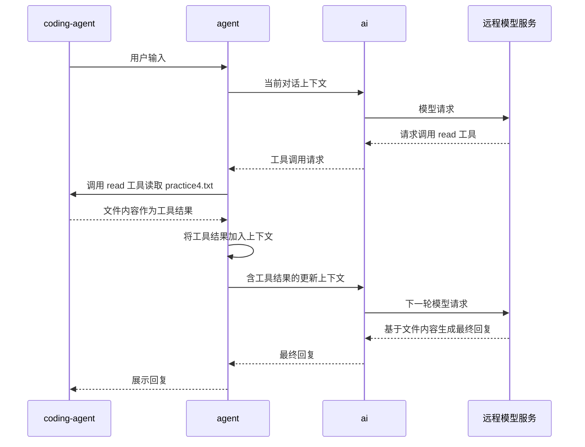

> *如果上图无法渲染，图片如下：*
>
> 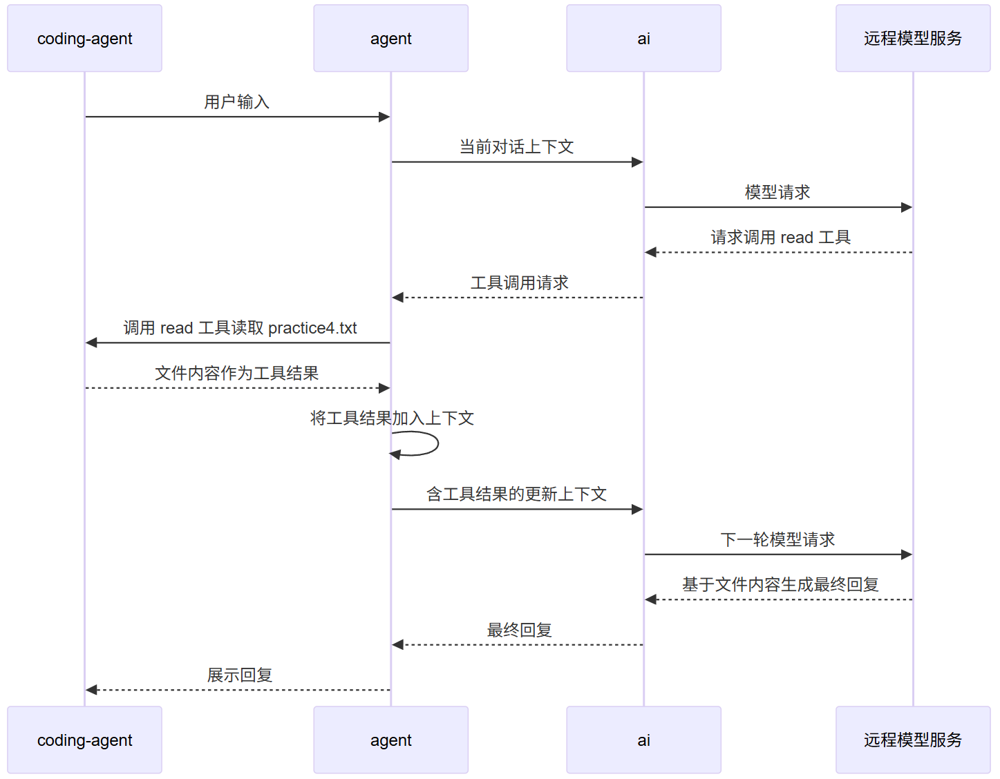