# 实践课 5：Pi Agent 源码泛读与功能定位

姓名：jinsilong

学号：202430142017

GitHub：Telemono

组织：fishplasma

## 一、单轮交互与工具调用

### 创建 `handoff.txt`

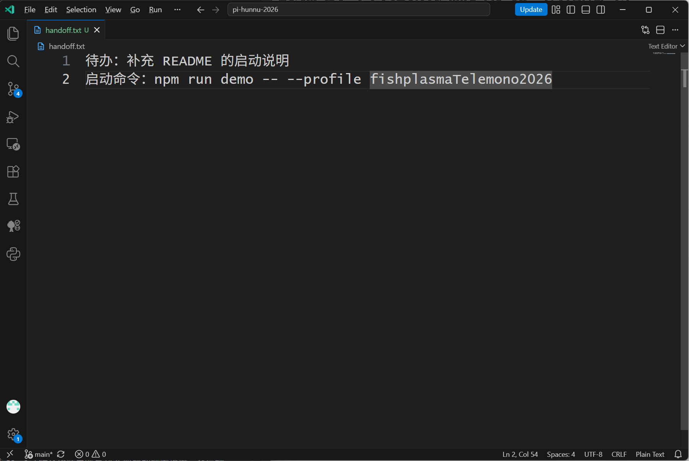

执行结果如下，这次用的是带时间戳的版本。

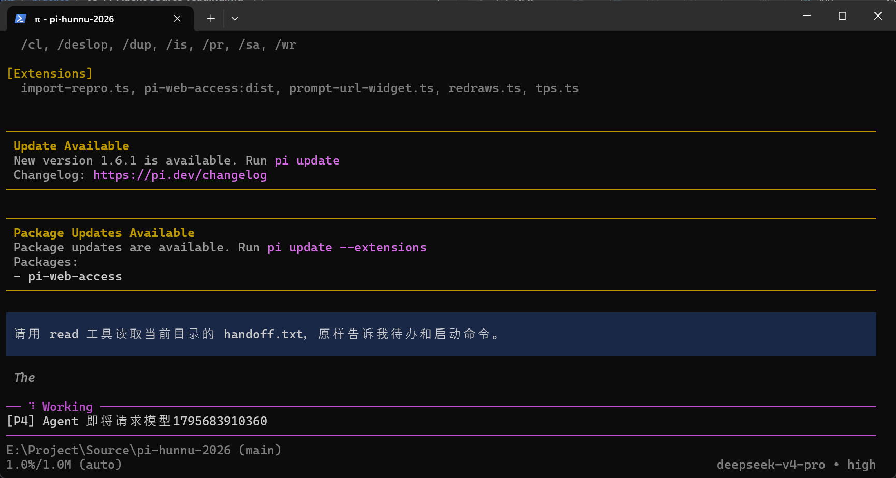

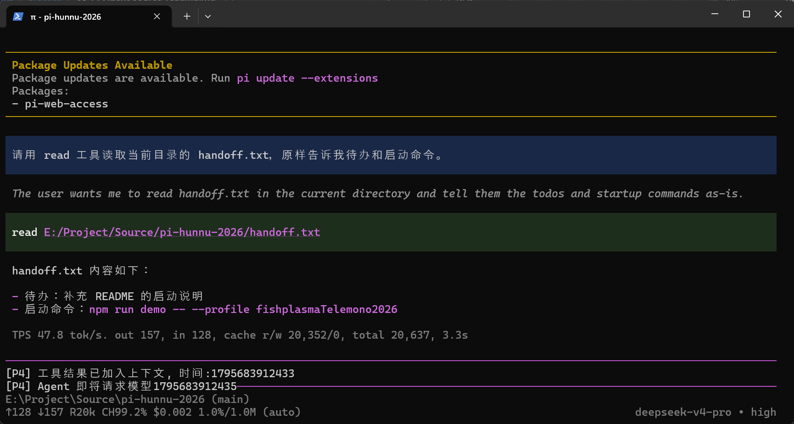

所以执行了1次工具调用，2次请求模型，即：请求模型→工具调用→请求模型。

### 单轮工具调用的代码级时序图的绘制

> 以实际读取 `handoff.txt` 的那一轮为例。
>
> 主图可按职责用五条生命线：用户、交互与会话层、Agent 执行层、模型请求层、`read` 工具。
>
> 生命线可以合并同一层的对象，箭头和注释要写**真实的函数**或**语句**。用**自调用或注释**标出同一层中的跨文件调用。
>
> 提示：
>
> - **输入入口**：`interactive-mode.ts` 的编辑器 `onSubmit`
> - **启动循环**：`agent.ts` 的 `Agent.prompt()`
> - **模型与文件边界**：在模型请求层标明适配器与远端模型之间的请求和响应。文件系统调用标在 `read` 工具下，按源码核对实际走的是流式读取还是缓冲区读取。
> - **显示回复**：回到 `interactive-mode.ts`，定位会话订阅和处理 `message_update` 或 `message_end` 的分支，标出用户看到回复的位置。

截图记录的这次交互中，`read` 工具执行一次，Agent 请求模型两次。文本文件经 `createReadStream` 和 `selectLinesFromStream` 流式读取；不是 `fsReadFile` 缓冲区路径。模型适配器由所选模型的 provider/API 实现承接请求并返回 assistant 消息，其中第一次响应含工具调用，第二次响应含最终文本。

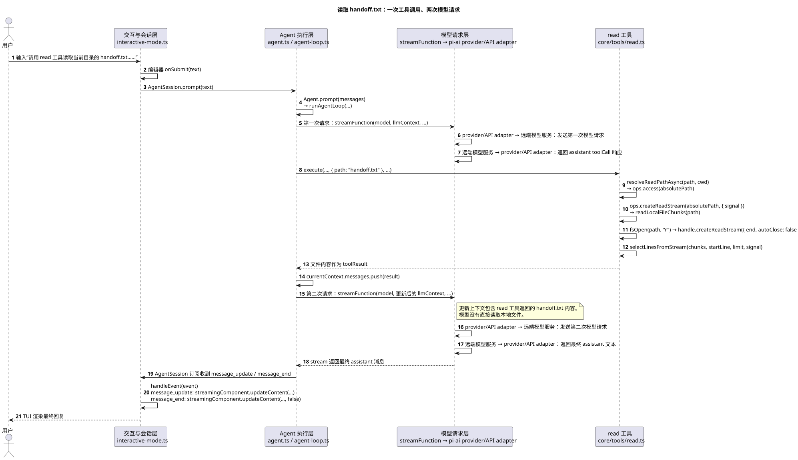

> [!note]
>
> [PlantUML 源文件](./assets/handoff-read-sequence.puml)
>
> 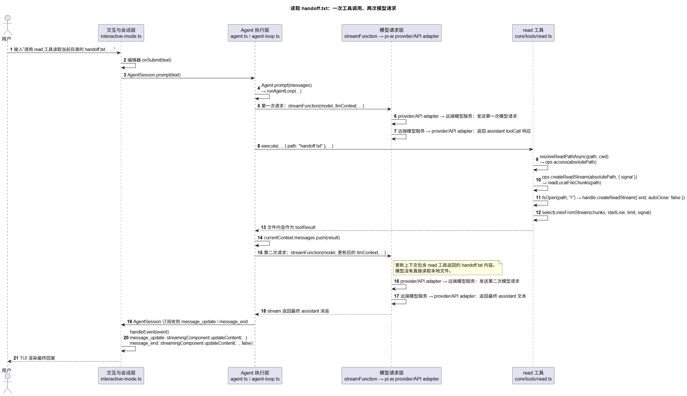
>
> 这张时序图对应终端截图中读取 `handoff.txt` 的一次实际交互。
>
> - 用户提交问题后，`interactive-mode.ts` 的 `onSubmit` 将输入交给会话层；
> - 会话调用 `Agent.prompt()`，由 `runAgentLoop(...)` 启动循环。
>   - 第一次 `streamFunction(...)` 请求返回包含 `read` 工具调用的 assistant 消息。
>   - Agent 执行 `read`。
>   - 读取结果写入 `currentContext.messages` 。
>   - 发起第二次模型请求。
>   - 第二次请求因此带上了工具结果，模型随后生成最终回复。
>
> > [!warning]
> >
> > `read` 是在 Pi 本地执行的工具，不是远端模型直接打开文件。
> >
> > - 文本文件走流式读取路径：`readLocalFileChunks` 使用 `fsOpen` 和 `handle.createReadStream` 读取数据；
> > - `selectLinesFromStream` 选出要返回的文本；
> > - 缓冲区读取函数 `fsReadFile` 不在这条路径上；
> > - 回复通过会话订阅到达 `handleEvent`，`message_update` 更新流式内容，`message_end` 完成 assistant 消息的显示。

## 二、恢复上次会话，继续写 README

### 情况1 恢复原会话

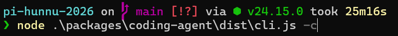

用上面的命令重新打开，可以看到session在继续，能看到之前的聊天记录。

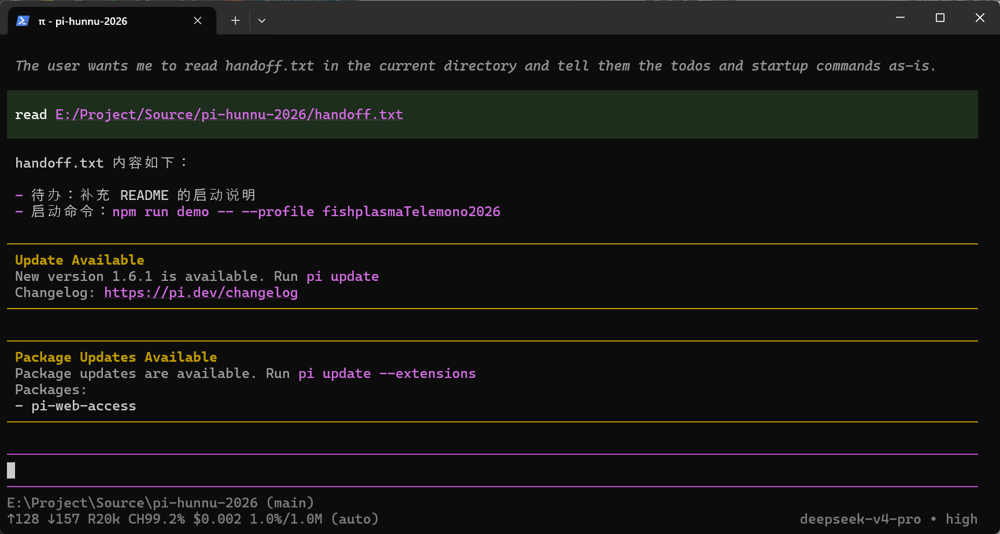

> 接着上次的待办，给 README 起草一条启动说明，写出交接单里的完整启动命令。只用这次会话已有的信息。不要调用工具。如果缺少命令，请直接说明。

#### 情况1的答案

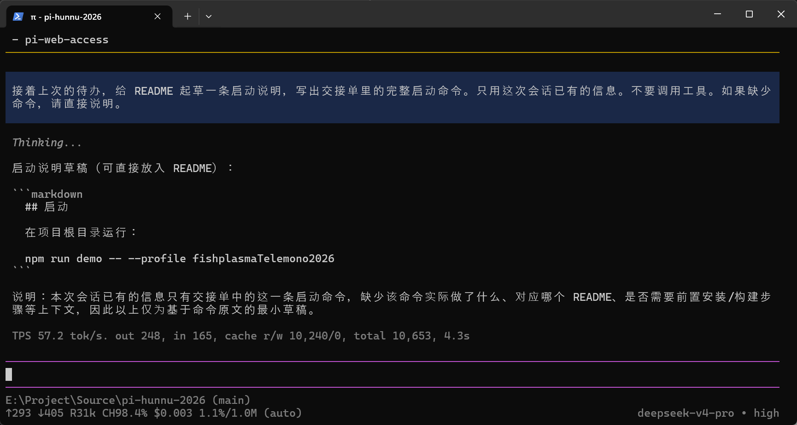

因为有了上文的加持，即使不调用工具，也能回答了。

#### 工具调用情况

如图，没有调用工具。

### 情况2 新建会话

用 `/new` 开始新会话。

同样说：

> 接着上次的待办，给 README 起草一条启动说明，写出交接单里的完整启动命令。只用这次会话已有的信息。不要调用工具。如果缺少命令，请直接说明。

#### 情况2的答案

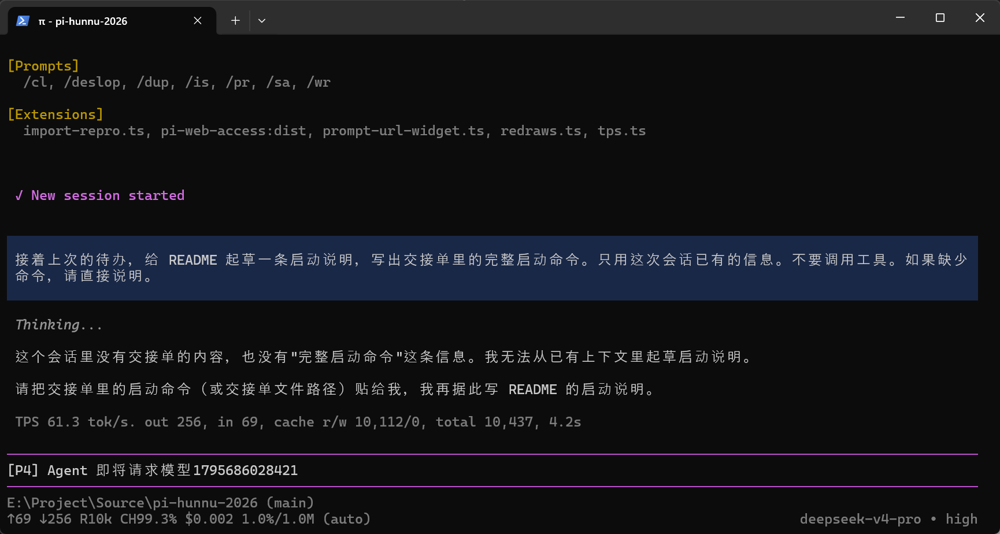

回答不了。

#### 工具调用情况

没有调用工具。

### 对照图

> 画一张有两条分支的流程图，说明 Pi 在两种情况下会把哪些聊天消息发给模型。

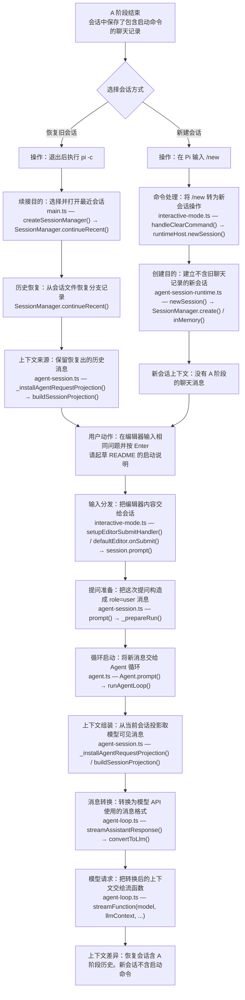

> [!note] 
>
> 这张流程图对比的是提交同一句提问时，两种会话历史的差别。
>
> - 恢复旧会话时：
>   - `-c` 重新打开 A 阶段保存的会话，Pi 从中恢复之前的聊天消息；
>   - 新提问会与这些历史消息一起成为模型请求的对话上下文，因此模型可以利用 A 阶段读取并回答过的启动命令。
> - 新建会话时，`/new` 创建空的聊天历史；
>   - 模型请求包含这次提问，但历史中没有 A 阶段读取到的启动命令；
>   - 所以在不调用工具的前提下，模型无法从这段新会话历史中得知它。
>
> 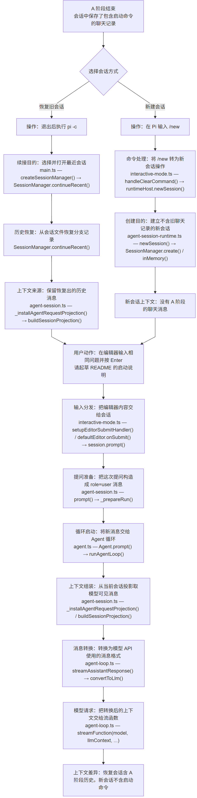

